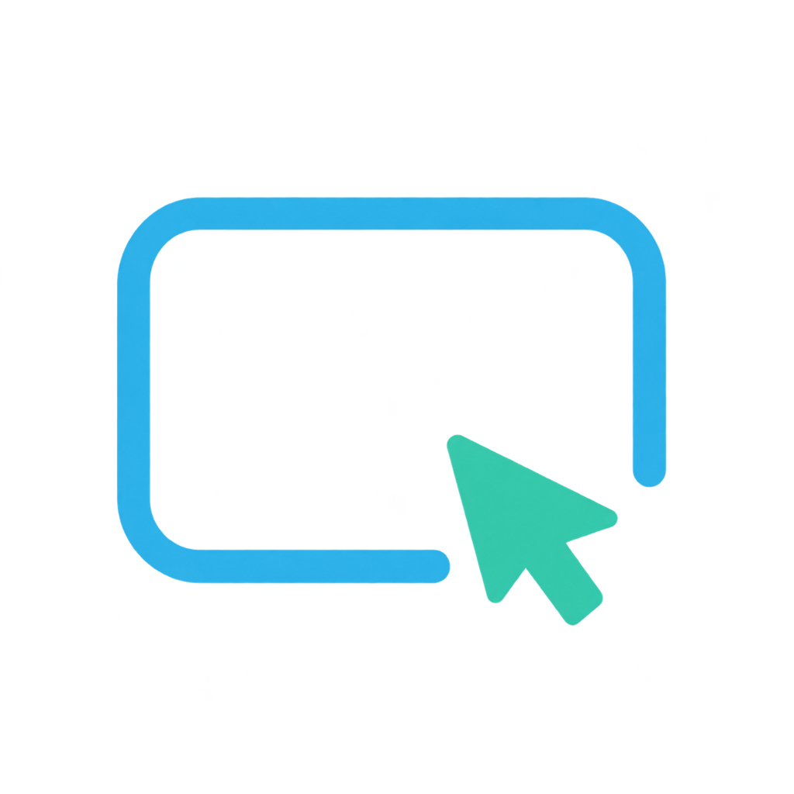

# remote-go

**English** · [简体中文](README.zh-CN.md)

Remote Go is a remote desktop prototype written in Go. To connect, enter the device code and verification code shown on the computer you want to control. Both endpoints embed [tailcat](https://github.com/tailscale/tailcat), which provides Tailscale's WireGuard transport, NAT traversal, and DERP relays without its control plane. You can use the public relays without creating an account or running a server.

```text
Controller (Remote Go)                              Host
┌─────────────────────────────┐                     ┌────────────────────────────┐
│ Native NSGo interface       │   WireGuard tunnel  │ tailcat node, port 7900    │
│ Native video decoding       │ ◀═════════════════▶ │ Screen → GPU H.264 → WS    │
│ tailcat client              │  Direct UDP or DERP │ Keyboard and mouse input   │
└─────────────────────────────┘                     └────────────────────────────┘
```

## How connections work

The node public key, preshared key, and DERP region determine the tailcat address. The discovery key also derives from the node key. Given the same device code, verification code, and relay configuration, both endpoints can derive the address independently. The derivation lives in `internal/tunnel`.

```text
Device code       = 8 random digits + 1 region digit
                    (1 New York, 2 San Francisco, 3 Frankfurt, 4 Tokyo → DERP 301–304,
                     0 for a self-hosted relay)
Verification code = current host password (8 characters by default, random or user-set)
Argon2id(verification code, salt = "remote-go/tailcat/v1|" + device code, t=3, m=64MiB, p=4)
                  → 64 bytes = WireGuard node private key (32) ‖ WireGuard preshared key (32)
```

- The **host** starts tailcat with the derived private key, joins the DERP region in its device code, and listens on port 7900 inside the tunnel. On first launch it measures relay latency unless you select a relay in Settings.
- The **controller** derives the address, pings the host, and opens a WebSocket through the tunnel. The magicsock transport starts on DERP and attempts a direct UDP connection through NAT. The floating control button in the session window shows the active route.
- An incorrect code derives a different public key. From the controller, the result looks the same as an offline host.
- Changing the verification code restarts the host with a new key, immediately invalidating the old code and disconnecting existing sessions.

## Configure a tailcat relay

On the desktop, open **Settings → Network → Local bootstrap relay** (设置 → 网络 → 本机引导中继), choose a relay, and click **Apply** (应用).

- **Automatic** measures latency to the public relays and saves the selection so the device code stays the same across restarts.
- **Public region** lets you choose New York, San Francisco, Frankfurt, or Tokyo. The controller reads the region from the last digit of the host's device code.
- **Self-hosted** uses your own DERP server. Enter its hostname and optional port (for example, `derp.example.com:8443`) in **自建 DERP 地址**. The default TLS port is 443. The certificate must match the hostname and be trusted by the client. The resulting device code ends in `0`. Save the same address in desktop Settings or on the Android home screen. The controller can keep its own public relay selection for incoming connections.

Changing the local relay restarts the host service and disconnects anyone controlling that computer. The first eight digits stay the same. Share the updated full device code with the other person. If you change your self-hosted relay address, update the address on the controller as well. Older device codes ending in 1–9 still use their original public relays.

## Desktop client

Download an installer from [GitHub Releases](https://github.com/i5shuyi/remote-go/releases/latest), or build one locally.

```bash
sh scripts/build.sh mac       # → bin/build-mac/<version>/releases/*.dmg
sh scripts/build.sh windows   # → bin/build-windows/<version>/releases/*-setup.exe (requires makensis)
sh scripts/build.sh linux     # → bin/build-linux/<version>/releases/*.deb, *.AppImage (amd64 and arm64)
```

1. On the **host**, the **Local device** (本机设备) card shows a nine-digit **device code** and an eight-character **verification code** by default. You can copy the device code, generate a new verification code, or set a fixed password in Settings. The lower-left corner shows the relay region.
2. On the **controller**, enter the host's device code under **Connect to a device** (连接设备), click **Connect** (连接), and enter the verification code. Each host opens in its own session window. The desktop fills the window, with a floating **•••** control button in the upper-right corner. Drag it anywhere. Release it near an edge to snap it there, or release it in the middle to leave it in place. Click it to see the codec, frame rate, bit rate, latency, and connection route. The menu also lets you adjust quality, frame rate, or resolution, enter full screen, send Ctrl+Alt+Del, or disconnect. Keyboard input goes to the host as soon as the session opens or the menu closes.
3. To copy between devices, enable **Shared clipboard** (共享剪贴板) in the floating button's menu. Text, screenshots, and regular files copied afterward sync in both directions. Copy a screenshot and press ⌘V or Ctrl+V in a remote chat that accepts images. To paste one or more copied files, open the destination folder in Finder or File Explorer. If you press paste during a transfer, the client waits for the receiver to acknowledge the files before sending the keystroke. Sharing starts off for each session, including after reconnecting, and is disabled in view-only sessions. Older peers with text-only clipboard support sync text.
4. Under **Recent connections** (最近连接), click **Reconnect** (重新连接) next to a device. When someone is controlling your computer, a banner at the top lets you disconnect them.
5. Closing the main window leaves the host running in the macOS menu bar or Windows notification area. Use its menu to reopen the window or quit. On macOS you can also quit with ⌘Q.
6. If the peer quits or loses its network connection, the session detects the missing heartbeat within six seconds. The disconnect screen shows the reason and lets you reconnect.

The desktop interface uses AppKit views on macOS, Direct2D on Windows and GTK 4 on Linux. The remote screen is a native component registered with NSGo (`internal/screen`, `core.Native`). [NSGo](https://github.com/nsgo-dev/nsgo)

- **macOS** uses an `NSView` with an `AVSampleBufferDisplayLayer`. The client converts Annex-B video into AVCC-formatted `CMSampleBuffer` objects for VideoToolbox hardware decoding. The system compositor displays the result without a CPU copy. The view handles native keyboard and mouse events, including physical key codes, left and right modifiers, and Command shortcuts.
- **Windows** embeds a child `HWND` in the NSGo window. A Media Foundation H.264 decoder (MFT) outputs NV12, which the client converts to BGRA and scales with GDI. Keyboard input uses layout-independent scan codes.
- **Linux** hosts a GTK 4 widget in the NSGo window. GStreamer decodes H.264 (VA-API or NVDEC when available, otherwise `avdec_h264` or OpenH264) into a `GtkPicture`. Keyboard input uses layout-independent evdev keycodes. Without a GStreamer H.264 decoder the controller asks the host for JPEG.

On Linux, the host encodes H.264 with the first GStreamer encoder that starts (`vah264enc`, `vaapih264enc`, `nvh264enc`, `x264enc`, `openh264enc`) and falls back to JPEG. The shared clipboard syncs text through the X11 `CLIPBOARD` selection (no images or files yet).

- **X11** captures the screen with `ximagesrc` and injects keyboard and mouse input through XTEST.
- **Wayland** goes through xdg-desktop-portal. The host opens one RemoteDesktop session with screen sharing (ScreenCast only for `-view-only`), records its PipeWire stream with `pipewiresrc`, and sends input through the portal by evdev keycode. When the host starts, the desktop asks which screens to share and whether to allow remote control. Someone at the computer must approve the first time. The portal's restore token is saved under `~/.config/remote-go/`, so later sessions start without asking until the permission is revoked. Text from the Android keyboard is sent as keysyms, so characters the host's layout lacks, such as Chinese, are skipped. The clipboard works only where the compositor bridges XWayland's clipboard, as GNOME and KDE do. The JPEG fallback still uses portal screenshots, which are slow.

GTK 4 and GStreamer load at runtime, so install them from your distribution, for example on Debian or Ubuntu:

```bash
sudo apt install libgtk-4-1 gstreamer1.0-plugins-base gstreamer1.0-plugins-good gstreamer1.0-plugins-bad gstreamer1.0-plugins-ugly gstreamer1.0-libav gstreamer1.0-vaapi gstreamer1.0-pipewire xdg-desktop-portal
```

Releases include a `.deb` for amd64 and arm64. It installs the app in `/opt/remote-go`, adds `remote-go` to the path and a menu entry, and pulls in the required GStreamer plugins, with the hardware codecs and the PipeWire and portal packages as recommendations. Install it with `sudo apt install ./remote-go-<version>-linux-x64.deb`. Releases also include an AppImage for each architecture. It needs FUSE and does not bundle GTK 4 or GStreamer, so install those from your distribution first, then `chmod +x` the file and run it. Updates open the release page for AppImage users, who download the new file themselves. Other distributions can also build the binary with `GOOS=linux CGO_ENABLED=0 go build -o remote-go .`

The Go session client (`internal/client`) opens its WebSocket directly through the tailcat tunnel. Use these environment variables for development and debugging.

| Variable | Effect |
| --- | --- |
| `RG_DEV_CONNECT=<device-code>/<verification-code>` | Connect through tailcat at startup. |
| `RG_DEV_SESSION=127.0.0.1:7900/<verification-code>` | Connect directly to a local test host started with `remote-go local`. |
| `RG_VERBOSE=1` | Print tailcat logs. |
| `RG_SCREEN_DEBUG=1` | Print decoder status. |
| `RG_DEV_SNAPSHOT=<directory>` | Save window snapshots as PNG files (macOS only). |

The end-to-end tests require internet access to a public DERP relay. The second command starts a host with a test pattern and prints the codes you can use to connect from the desktop client.

```bash
RG_TAILCAT_E2E=1 go test ./internal/tunnel -run TestTailcat -v
RG_TAILCAT_HOST=1 go test ./internal/host -run TestServeTailcat -v -timeout 10m
```

## Android client (controller only)

```bash
sh scripts/build.sh android
adb install -r bin/build-android/0.5.2/releases/remote-go-0.5.2-android-arm64.apk
```

Building the APK requires Python 3.9+, JDK 17+, Android SDK Platform 34 or later, and Build Tools 36+ with d8. Use `ANDROID_HOME` to specify the SDK location.

Use Android to control a computer by entering the codes shown on its desktop. Recently connected computers appear on the home screen.

- **Video.** The NSGo Android runtime cannot embed an application-provided native view, so the client displays video in a WebView (`internal/mobile/player.html`). Go receives H.264 frames over tailcat and passes them to the page. WebCodecs decodes them through Android System WebView's MediaCodec hardware backend. If playback falls behind, the page drops delta frames and requests a keyframe.
- **Controls.** The floating button starts in the upper-right corner. Drag it and release it near an edge to snap it into place. Tap it for the keyboard, input mode, fit-to-screen, Ctrl+Alt+Del, quality, frame rate, and disconnect controls.
  - In touch mode, tap to left-click, press and hold to right-click, and drag with one finger to drag on the remote desktop.
  - In trackpad mode, move one finger to move the pointer, tap to left-click, tap with two fingers to right-click, and tap then press and drag to drag an item.
  - In either mode, scroll with two fingers or pinch to zoom up to 5×.
- **Shared clipboard.** Enable sharing manually in the session panel. After copying text, a screenshot, or files on the phone, return to the session to sync them to the computer. File managers must put files on the Android system clipboard for sharing to work. A copy held inside another app is inaccessible to Remote Go.
- **Keyboard.** The input field sends Unicode text in a `tx` message. The host uses `CGEventKeyboardSetUnicodeString` on macOS, `KEYEVENTF_UNICODE` on Windows and temporary keysym bindings on Linux X11, so Chinese input works independently of the host keyboard layout. An extra row supplies Esc, Tab, arrows, Del, Home/End, F5, and other keys. Tap Ctrl, Alt, Shift, or ⌘ (Win) to apply the modifier to the next key.
- **Networking.** The Go program runs as a regular Android executable with restricted access to the network interface list. tailcat uses Tailscale's `androidbin` and `androiddns` packages for interface discovery and DNS.
- The screen stays awake during a session. The Android Back button dismisses the keyboard, then the toolbar, then asks whether to disconnect. As on desktop, you can reconnect from the disconnect screen.
- To debug the mobile layout on a desktop, run `RG_MOBILE=1 ./remote-go`. It opens the same interface in a phone-sized window. WKWebView on macOS also supports WebCodecs.

## Updates and releases

Starting with 0.3.0, desktop **Settings** (设置) and Android **Default settings** (默认设置) show the current version and offer **Check for updates** (检查更新). Release builds check daily by default. macOS updates through Sparkle. Windows updates the current user's installation through WinSparkle. On Linux, an installation from the `.deb` downloads the signed package, installs it with `pkexec dpkg` (which asks for an administrator password), and restarts. The AppImage opens the release page instead. Android verifies the APK and opens the system installer. Users on 0.2.x or earlier need to install a version with the updater manually once.

Desktop builds starting with 0.4.0 can replace the main application during a remote session. The host keeps its tunnel and verification code, and each controller window keeps its video, keyboard input, and ongoing clipboard transfers. During an active session the new main interface starts in the menu bar or notification area. Choose **打开 Remote Go** to open it. New controller windows use the installed version. The host worker switches when its viewers and session windows have closed. Choosing **退出 Remote Go** from the main application's tray menu still ends all sessions.

Schedule the first upgrade from 0.3.0 between sessions. On macOS, if prompted, grant the session helper Screen Recording and Accessibility permissions. Android updates still use the system installer.

Each OS and architecture reads its own `appcast-<target>.xml` from the latest GitHub Release. The feed points to the full installer under the corresponding version tag. Each package has an Ed25519 signature.

GitHub Actions runs the Go tests and builds the eight preview packages for pull requests, pushes to `main`, and manual runs. Download the seven-day test artifact from the **Build and release** workflow. Preview APKs use a temporary signing identity.

To release, commit the new `version` in `nsgo.yaml` and push the matching stable tag, for example `v0.5.2`. The tag workflow uses the `NSGO_UPDATES_KEY` and `ANDROID_SIGNING_PEM` Actions secrets for the existing update and APK signing identities. It verifies the signed files, checks all 28 draft assets, publishes the release as **Latest**, then downloads the public feeds and installers to verify them. Rerun a failed release job to resume its draft or recheck an already published version.

For a local signed build, run `sh scripts/build.sh release` on macOS with Go, the Xcode command line tools, NSIS and the Android tools listed above. The script reads the update key from `NSGO_UPDATES_KEY` or `~/.config/remote-go/updates.key`, and the APK signing identity from `.nsgo/android/debug.pem`. Keep independent backups of both private keys.

## Command-line usage

Run the binary without arguments to open the desktop client. Subcommands run without a desktop window and can be used on servers or unattended machines.

```bash
go build -o remote-go .
./remote-go host -p mypassword               # Start a host and print its device and verification codes
./remote-go view -p mypassword 868987922     # Connect over tailcat and open the browser controller (WebCodecs)
./remote-go local                            # Test on 127.0.0.1 without a tunnel
./remote-go host -region 304                 # Use the Tokyo public relay
./remote-go host -derp derp.example.com:8443
./remote-go view -derp derp.example.com:8443 -p mypassword 123456780  # Substitute the host's codes
```

| Option | Purpose |
| --- | --- |
| `host -region 304` | Select a public relay. If omitted, the host uses the fixed device code's region or measures relay latency. |
| `host/view -derp host[:port]` / `RG_DERP` | Use the same self-hosted DERP address on both endpoints. A fixed device code must end in the digit for the selected relay. |
| `host -device 123456782` / `RG_DEVICE` | Set a fixed device code. By default the host generates a code after choosing the closest region by latency. |
| `host -p xxxx` / `RG_PASSWORD` | Set a fixed verification code. The default is a new random code on each start. |
| `host -view-only` | Allow viewing only and disable remote keyboard and mouse input. |
| `host -display 1` | Select the display to share. |
| `host -name Office` | Set the device name shown to the controller. |
| `-v` | Print tailcat diagnostic logs. |
| `view -listen 127.0.0.1:0 -no-open` | Set the local proxy's listen address and suppress automatic browser launch. |

## Security model

1. **Transport.** WireGuard (Noise IK plus a preshared key) encrypts the connection end to end. The DERP relay sees ciphertext and public keys. The host listens only inside the tunnel.
2. **Authentication.** Deriving the node public key and preshared key for the handshake requires both the device code and the verification code. DERP has no node-listing API.
3. **Offline guessing.** Each guess costs one Argon2id computation with 64 MiB of memory. An attacker needs the device code to target a particular host. The default random verification code draws eight characters from an alphabet of 31, giving about 2^39.6 combinations. You can set a longer fixed password in Settings.
4. **Online guessing.** An incorrect guess produces an unanswered handshake that the host never sees, so the host cannot rate-limit these attempts. Resistance depends on verification-code entropy and the cost of Argon2. **Avoid short, common fixed passwords.**
5. The WebSocket inside the tunnel checks the verification code again using a constant-time comparison and locks out repeated failures.
6. By default the app uses the public tailcat DERP relays operated by Tailscale. You can also configure your own. Public relay availability and bandwidth are best-effort. Once a direct connection succeeds, video travels directly between peers.

## Platform support

| Platform | Screen streaming | Keyboard and mouse input |
| --- | --- | --- |
| macOS | **Hardware H.264 encoding** with ScreenCaptureKit and VideoToolbox. Requires Screen Recording permission. | CGEvent. Requires Accessibility permission. |
| Windows 10/11 (x64/ARM64) | **Hardware H.264 encoding** with DXGI Desktop Duplication, the D3D11 video processor, and Media Foundation. | SendInput |
| Linux | JPEG frames on X11 | View only |
| Android | Controller only, with hardware decoding through WebCodecs and MediaCodec | — |

### macOS hardware encoding

```text
ScreenCaptureKit → NV12 IOSurface (GPU memory and scaling) → VideoToolbox H.264
                 → Annex-B over WebSocket → controller decoder
```

- VideoToolbox uses the media engine with low-latency rate control and no B-frames. Native controllers decode with VideoToolbox or Media Foundation. The CLI browser controller uses WebCodecs.
- The capture and encode path keeps pixels on the GPU without CPU copies. ScreenCaptureKit emits no new frames for a static screen, so bandwidth drops close to zero.
- The stream falls back to JPEG if the browser lacks WebCodecs or hardware encoding fails to start on the host, for example when Screen Recording permission is missing.
- On a decoder error or frame backlog, the browser requests a keyframe. Changing quality, frame rate, or resolution rebuilds the encoding session.
- The quality preset determines the target bit rate. Standard quality at 1920×1080 and 15 fps targets about 2.5 Mbps.

### Windows hardware encoding

```text
DXGI Desktop Duplication (BGRA texture) → CopyResource → D3D11 Video Processor (BGRA to NV12, GPU scaling, BT.709)
    → D3D11 texture (IMFDXGIDeviceManager, zero copy) → Media Foundation hardware H.264 MFT (NVENC / Intel QSV / AMD AMF)
```

- Go calls COM through syscalls, so you can cross-compile with `GOOS=windows go build` without cgo or MinGW.
- The project generates COM vtable indices from mingw-w64 IDL and checks struct sizes at compile time. [Vtable generator](internal/encoder/genvtbl)
- The host tries each available hardware encoder in turn. It falls back to JPEG if all fail, which can happen without a GPU, in a Remote Desktop session, or on Windows N without the Media Feature Pack.
- The encoder uses constant bit rate and low-latency mode with no B-frames. On a keyframe request, it forces an IDR frame with `CODECAPI_AVEncVideoForceKeyFrame`, re-encoding the last frame if the screen is static.
- To verify on a Windows machine, run `go test ./internal/encoder/ -run TestMediaFoundation -v`.

## Known limitations and future work

- Windows Desktop Duplication omits the mouse pointer. The controller displays its local pointer. Changing the host's display resolution triggers a fallback to JPEG. Rotated displays and HDR are unsupported.
- Video travels over WebSocket over TCP, so packet loss can delay subsequent frames through head-of-line blocking. A potential alternative is WebRTC over UDP using Pion.
- Native clients share plain text up to 32 KiB, PNG images up to 32 MiB and 33,554,432 pixels, and up to 128 regular files totaling 1 GiB per transfer. Folders and symbolic links are skipped. Received files are staged in the app cache and can be pasted once the entire transfer finishes. The browser controller lacks shared clipboard support. Audio streaming is also unsupported.
- Android passes frames from Go through Java to the WebView as base64 messages. The bridge adds a few milliseconds of latency and some CPU overhead. High bit rates, such as high-quality 4K at 60 fps, may cause the client to drop frames and resync. The Android interface and WebView have been tested on macOS only. Testing on an Android device or emulator is still pending. The APK currently targets arm64 only.
- The Windows controller displays video with GDI and converts NV12 to BGRA on the CPU. This works at 1080p, but high-frame-rate 4K playback can be CPU-intensive. A D3D11 swap chain could display decoded textures directly. Capturing the Windows key and Alt+Tab would require a low-level keyboard hook.
- The NSGo v0.2.0 API may require UI changes when upgrading. On macOS, `go tool nsgo build` disables cgo. This project requires cgo, so use `scripts/build.sh` to package it.
- Windows hosts cannot show the UAC secure desktop or sign-in screen. Supporting these would require running as a SYSTEM service.
- NAT traversal coordination and relay fallback use the selected public or self-hosted DERP server. tailcat is experimental, and its API and public relay regions may change.
- When both peers are behind symmetric NATs, the connection uses DERP. The relay then determines the available bandwidth and latency.
